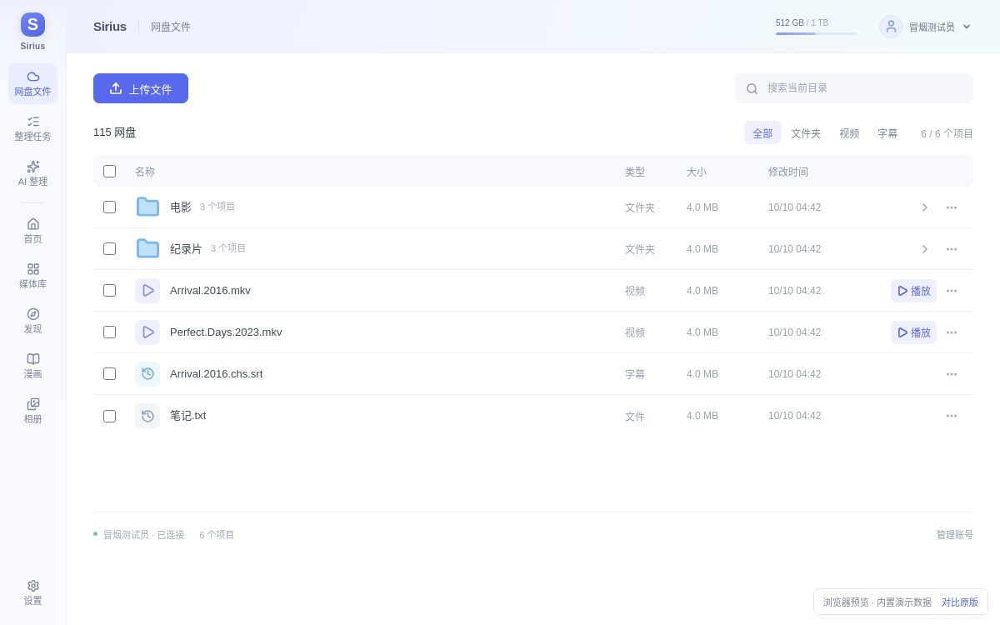
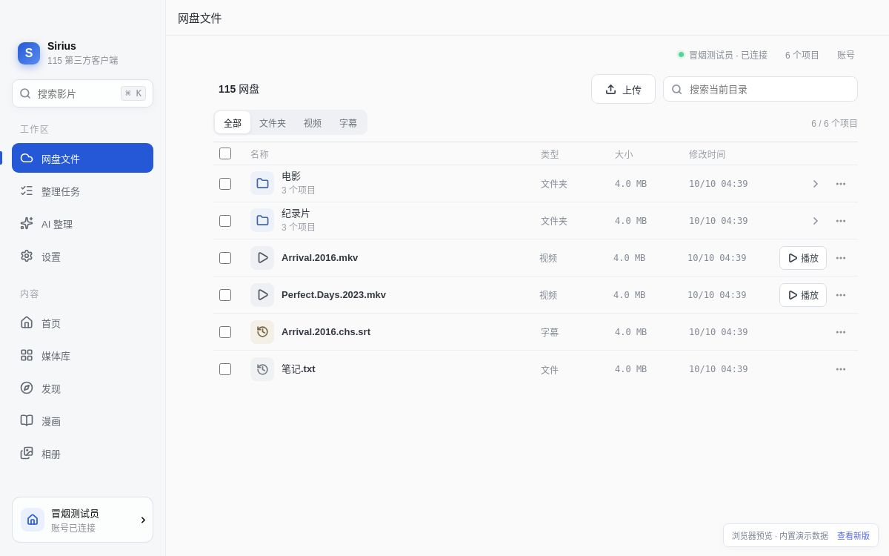
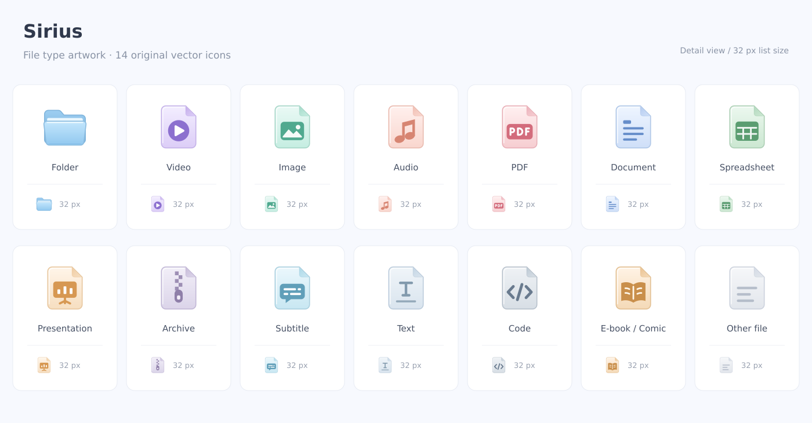
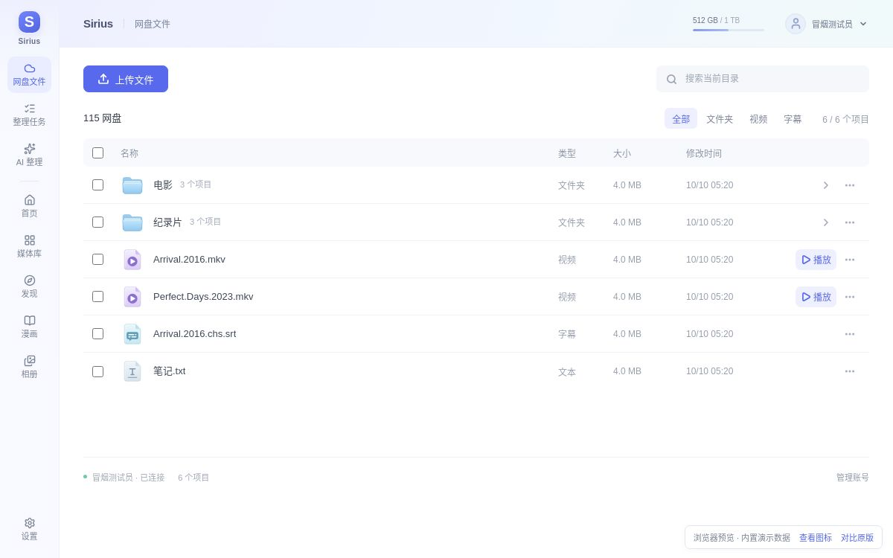

# Quark-inspired desktop UI

This revision follows the light desktop-client visual direction shown on
[Quark Drive's official site](https://pan.quark.cn/), while retaining Sirius
branding and its existing 115 workflows.

## Preview comparison

These are actual 1200 × 750 renders of the browser frontend using the same
repository-provided demo data. They do not show a native macOS window or a
real 115 account.

### Updated workspace



### Previous workspace



## Changes

- 80 px navigation rail with all nine existing sections, active-page semantics,
  task badges, and a fixed settings entry.
- 64 px pale blue/lavender toolbar with the current page, account management,
  and capacity values from the existing cloud profile.
- Media search in the toolbar on Home, Library, and Discover, with a working
  Cmd/Ctrl+K shortcut and clear action.
- White file workspace, blue upload action, quieter type filters, 50 px rows,
  selection highlighting, and light blue folder icons.
- Shared compact headings, controls, borders, and surfaces for AI organization,
  comics, albums, tasks, and settings.

## File-type artwork

The file workspace now uses 14 original, locally bundled SVG designs for
folders, videos, images, audio, PDF, documents, spreadsheets, presentations,
archives, subtitles, text, code, e-books/comics, and unknown files. Each design
uses a 40 × 40 viewBox and keeps a recognizable glyph at the 32 px list size.
Navigation and action controls continue to use the shared Lucide wrapper.





- The canonical artwork is `src/components/FileTypeIcon.tsx`; all colors and
  gradients are inside each SVG, and React assigns unique IDs per instance.
- `src/domain/fileTypes.ts` resolves presentation from provider kind and file
  extension. A folder named `photos.zip` stays a folder; provider-recognized
  videos/subtitles retain their type. Classification does not enable extra
  backend actions or change the existing filters.
- `FileThumbnail` displays real 115 thumbnails, local comic covers, and album
  images first. A missing or failed image falls back to the same type artwork.
  An updated URL can load again without repeatedly requesting a failed URL.
- `thumbUrl` is an optional TypeScript field matching the existing Rust
  `thumb_url` output; no backend or credential changes are needed.
- [Individual SVG exports](assets/file-types/) and the
  [downloadable SVG set](assets/file-type-icons.zip) are derived from the
  component. The [vector overview](assets/file-type-icons.svg) is also included.

`App.css` retains the existing component styles; `Shell.css` and `Workbench.css`
apply the updated shell and workspace treatments in that order. This keeps
the change independent of service and Rust behavior.

## Validation

- `npm run build` passed (TypeScript and Vite).
- `git diff --check` passed.
- A source/CSS review confirmed all nine navigation callbacks remain present,
  dialog layers stay above the new toolbar, the player bar is offset from the
  narrow rail, and file actions remain available on hover, keyboard focus,
  and devices without hover.
- A 1200 × 750 hosted render of the file workspace was inspected. This caught
  a wrapped playback label; the action column now reserves enough space and
  playback labels do not wrap.
- The artwork was inspected at large and 32 px sizes. Filename checks covered
  uppercase extensions, leading-dot metadata, folders with file-like names,
  video `.ts` versus source `.ts`, compressed archives, comics, and unknown
  files. Static review caught and corrected the folder-picker icon slot's
  inherited flex sizing.
- Native macOS rendering, interactive browser checks, and live 115 operations
  have not been validated in this environment. The managed preview service
  could not mount `/proc`; the hosted preview requires a signed-in browser.

## Local visual review

```sh
npm ci
npm run dev
```

Open the Vite URL with `?e2e-mock=1` to use the repository's existing browser
demo data. This is a frontend preview, not a real account connection or a
native macOS app run. It does not establish that live uploads, downloads,
playback, scanning, or AI execution succeed.

Review the file list, selection and row menus; visit AI organization and
generate a preview; check the content sections and account dialog; then check
the media search shortcut and player placement in the native app. The app
continues to target desktop windows with an 860 × 620 minimum size.
